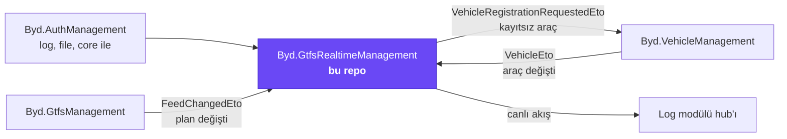
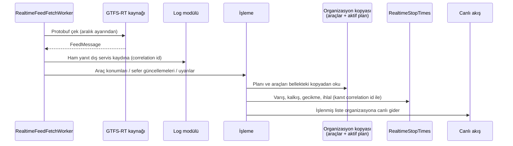
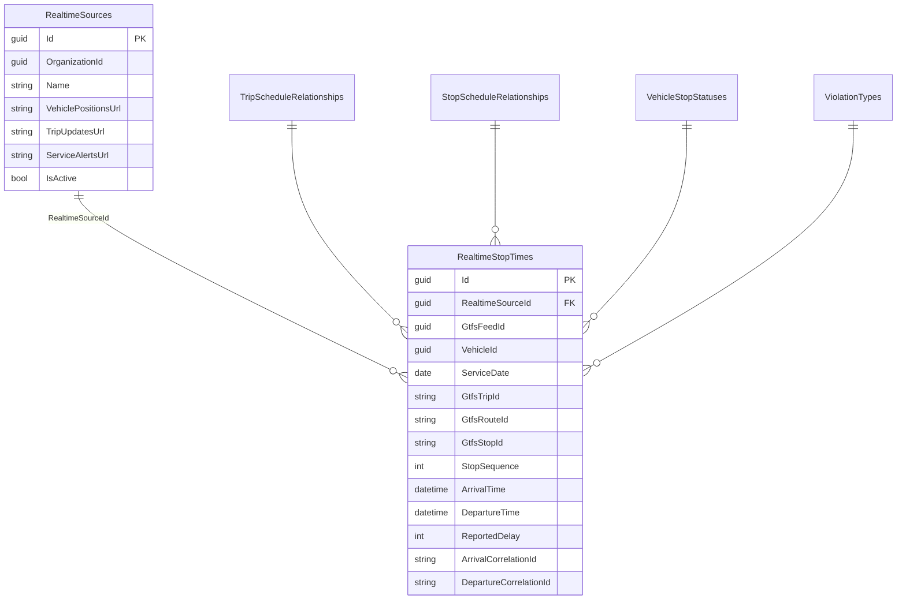

# Byd.GtfsRealtimeManagement

[](https://www.nuget.org/packages/Byd.GtfsRealtimeManagement.Domain)


Canlı toplu taşıma verisinin modülü. Bir organizasyonun GTFS-RT akışlarını (araç konumları, sefer güncellemeleri, servis
uyarıları) düzenli aralıklarla çeker, aktif tarifeyle karşılaştırır, her durağa varış ve kalkışı ölçer, erken ya da geç
kalkışları işaretler ve sonucu bağlı ekranlara canlı olarak akıtır.

## İçindekiler

- [Platformdaki yeri](#platformdaki-yeri)
- [Bir bakışta](#bir-bakışta)
- [Veri akışı](#veri-akışı)
- [Özellikler](#özellikler)
- [HTTP uçları](#http-uçları)
- [Olaylar ve işçiler](#olaylar-ve-işçiler)
- [Veritabanı](#veritabanı)
- [Yetkiler](#yetkiler)
- [Ayarlar](#ayarlar)
- [Hata kodları](#hata-kodları)
- [Bir modülde kullanmak](#bir-modülde-kullanmak)
- [Geliştirme](#geliştirme)

## Platformdaki yeri



## Bir bakışta

| | |
|---|---|
| Paket ailesi | `Byd.GtfsRealtimeManagement.*` |
| Sürüm | `0.1.0` (`common.props`) |
| Bağımlılık | Auth ve log paketleri (file ve core onlarla gelir), `SystemStandards.Core` |
| Kaynak biçimi | GTFS-RT protobuf, HTTP(S) ile çekilir |
| Canlı iletim | Log modülünün SignalR hub'ı (`streamReceived`) |
| Kapsam | Organizasyon; organizasyonun tek aktif kaynağı olur |

## Veri akışı

Modül iki katmanlı veri tutar. Ham akış her çekmede log modülünün dış servis kaydına yazılır (kanıt). İşlenmiş sonuç,
yani durak bazında ölçülen varış ve kalkışlar, bu modülün tablolarına yazılır ve kaydın hangi ham çekmeden geldiği
correlation kimliğiyle bağlanır.



## Özellikler

### 1. Realtime kaynakları

Kaynak bir organizasyonun GTFS-RT adresleridir: araç konumları, sefer güncellemeleri ve servis uyarıları için ayrı ayrı
adresler (en az biri dolu, mutlak HTTP(S)). Organizasyonun bir anda tek aktif kaynağı olur; `activate` öncekini pasife
alır. Kaynak uçları akış çekmez, yalnız tanımı yönetir.

### 2. Periyodik çekme

`RealtimeFeedFetchWorker` her aktif kaynağın her akışını organizasyonun ayarındaki aralıkla çeker. Aynı akış aralık
dolmadan yeniden çekilmez; çekme hata verse de aralık beklenir. Çağrılar log modülüne dış servis kaydı olarak yazılır.

| Akış | Varsayılan aralık |
|---|---|
| Araç konumları | 10 sn |
| Sefer güncellemeleri | 10 sn |
| Servis uyarıları | 60 sn |

### 3. Varış ve kalkış ölçümü

Araç konumu aktif plandaki durakla karşılaştırılır. Araç durağın yarıçapı içinde ve durma hızının altındaysa durağa varmış
sayılır; yarıçaptan çıkınca kalkmış sayılır. Ölçülen saat plandaki saatle karşılaştırılır.

| Kod | İhlal | Ne zaman |
|---|---|---|
| 1 | Yapılmayan sefer | Lookup'ta tanımlı; işleme adımı 2–5 arasındaki kodları yazar |
| 2 | İptal edilen sefer | Akış seferi iptal ya da silinmiş bildirdi |
| 3 | Durak atlama | Sefer durağa uğramadan geçti |
| 4 | Erken kalkış | Plandan tolerans süresinden (varsayılan 60 sn) daha erken |
| 5 | Geç kalkış | Plandan tolerans süresinden (varsayılan 300 sn) daha geç |

Bayat akış (varsayılan 120 sn'den eski) işlenmez. Seferin o gün çalışıp çalışmadığı GTFS takvim kuralıyla belirlenir:
günün `calendar_dates` istisnası haftalık takvimin önüne geçer.

### 4. Bellekte organizasyon kopyası

Her akışta veritabanına gitmemek için organizasyonun araçları ve aktif GTFS planı bir kez yüklenir ve bellekte tutulur.
Kopya periyodik sorguyla değil, olaylarla güncellenir:

| Olay | Kopyaya etkisi |
|---|---|
| GTFS modülünden plan değişikliği | Aktif plan yeniden yüklenir |
| Araç modülünden araç eklendi/güncellendi | Araç kimliği kopyaya yazılır |
| Araç silindi | Araç kopyadan çıkar; akışta yeniden görülürse yeniden kayıt istenir |

### 5. Kayıtsız aracı kaydettirme

Akışta görülen ama kopyada olmayan her araç için bir kez `VehicleRegistrationRequestedEto` yayınlanır; araç modülü aracı
"Realtime" kaynaklı olarak kaydeder ve araç olayıyla kopyaya geri döner.

### 6. Canlı akış

İşlenen liste log modülünün `StreamAsync` yoluyla organizasyonun bağlı ekranlarına gider (hub mesajı `streamReceived`,
ad akış türü). Boş tam liste de gönderilir ki istemci elindekini temizlesin; değişiklik yokken boş kısmi liste gitmez.
Canlı araç takibi için ayrıca bir sorgu ucu açılmaz; ekranlar akışı dinler.

### 7. Anlık görünüm uçları

Aktif kaynağın akışları istek anında da okunabilir: araç konumları, sefer güncellemeleri ve uyarılar GTFS-RT alanlarıyla
DTO olarak; `feed-message` ise bütün akışları tek bir GTFS-RT `FeedMessage` olarak döner.

### 8. Ölçüm kayıtları

Her durak ölçümü `RealtimeStopTimes` tablosunda durur: servis günü, sefer, hat, durak sırası, varış ve kalkış zamanı,
konum, bildirilen gecikme, durum ve ihlal türü. Satır, varış, kalkış ve durum bilgisinin geldiği ham çekmelerin correlation
kimliklerini taşır; böylece her ölçüm log modülündeki ham yanıta kadar izlenir.

## HTTP uçları

**`api/gtfs-realtime-management/realtime-sources`**

| Yöntem | Yol | Ne yapar |
|---|---|---|
| `POST` | `/` | Kaynak ekler |
| `GET` | `{id}` | Kaynak |
| `GET` | `{id}/including-inactive` | Pasif kaynak dahil |
| `GET` | `filtered-list` | Filtreli liste |
| `PUT` | `{id}` | Ad ve adresleri günceller |
| `POST` | `{id}/activate` | Aktif kaynak yapar |
| `DELETE` | `{id}` | Siler |
| `GET` | `vehicle-positions` | Aktif kaynağın araç konumları |
| `GET` | `trip-updates` | Aktif kaynağın sefer güncellemeleri |
| `GET` | `service-alerts` | Aktif kaynağın uyarıları |
| `GET` | `feed-message` | Bütün akışlar tek GTFS-RT mesajı olarak |

**`api/gtfs-realtime-management/realtime-stop-times`**

| Yöntem | Yol | Ne yapar |
|---|---|---|
| `POST` | `/` | Ölçüm ekler |
| `GET` | `{id}` | Ölçüm (aktif kaynak) |
| `GET` | `filtered-list` | Filtreli liste: kaynak, servis günü, sefer, hat, araç, ihlal türü |
| `GET` | `realtime-sources/{realtimeSourceId}/{id}` | Belirli kaynaktaki ölçüm |
| `GET` | `realtime-sources/{realtimeSourceId}/filtered-list` | Belirli kaynağın ölçümleri |
| `PUT` | `{id}` | Günceller |
| `DELETE` | `{id}` | Siler |

**`api/gtfs-realtime-management/lookups`**: `trip-schedule-relationships`, `stop-schedule-relationships`,
`vehicle-stop-statuses`, `violation-types`; her biri ekleme, okuma, liste, güncelleme, silme.

## Olaylar ve işçiler

| Olay / işçi | Yön | Ne yapar |
|---|---|---|
| `RealtimeFeedFetchWorker` | Periyodik işçi | Aktif kaynakların akışlarını çeker, işler, yazar, akıtır |
| `GtfsFeedChangedEto` | Dinler (GTFS modülü) | Organizasyonun plan kopyasını yeniden yükler |
| `VehicleEto` | Dinler (araç modülü) | Araç kopyasını günceller |
| `VehicleRegistrationRequestedEto` | Yayınlar | Kayıtsız aracı araç modülüne kaydettirir |
| `RealtimeSourceActivationRequestedEto` | Yerel | Aktif kaynağı aynı işlem içinde değiştirir |

## Veritabanı



| Tablo | Ne tutar |
|---|---|
| `RealtimeSources` | Organizasyonun GTFS-RT adresleri |
| `RealtimeStopTimes` | Durak bazında ölçülen varış, kalkış, gecikme ve ihlaller |
| `TripScheduleRelationships`, `StopScheduleRelationships` | GTFS-RT `schedule_relationship` değerleri (lookup) |
| `VehicleStopStatuses` | GTFS-RT `current_status` değerleri (lookup) |
| `ViolationTypes` | Yapılmayan sefer, iptal, durak atlama, erken ve geç kalkış (lookup) |

Ham akış tabloya girmez; log modülünün dış servis kaydında durur. Plan ve araç verisi kopyalanmaz, kimlikle bağlanır.

## Yetkiler

| İzin | Ne verir |
|---|---|
| `GtfsRealtimeManagement.RealtimeSources.View` / `.Manage` | Kaynakları görmek / yönetmek |
| `GtfsRealtimeManagement.RealtimeStopTimes.View` / `.Manage` | Ölçümleri görmek / düzeltmek |
| `GtfsRealtimeManagement.Lookups.View` / `.Manage` | Lookup'lar |

## Ayarlar

Organizasyon bazında ezilebilen ABP ayarlarıdır.

| Ayar | Varsayılan | Ne yapar |
|---|---|---|
| `GtfsRealtimeManagement.Fetch.VehiclePositionsIntervalSeconds` | 10 | Araç konumu çekme aralığı |
| `GtfsRealtimeManagement.Fetch.TripUpdatesIntervalSeconds` | 10 | Sefer güncellemesi çekme aralığı |
| `GtfsRealtimeManagement.Fetch.ServiceAlertsIntervalSeconds` | 60 | Uyarı çekme aralığı |
| `GtfsRealtimeManagement.Processing.StopRadiusMeters` | 50 | Durağa varış yarıçapı (metre) |
| `GtfsRealtimeManagement.Processing.StoppedSpeedMetersPerSecond` | 1.5 | Bu hızın altı "durdu" sayılır |
| `GtfsRealtimeManagement.Processing.StaleFeedSeconds` | 120 | Bundan eski akış işlenmez |
| `GtfsRealtimeManagement.Processing.EarlyDepartureToleranceSeconds` | 60 | Erken kalkış toleransı |
| `GtfsRealtimeManagement.Processing.LateDepartureToleranceSeconds` | 300 | Geç kalkış toleransı |

## Hata kodları

| Aile | Kapsadığı durumlar |
|---|---|
| `RealtimeSourceExceptionCodes` | Kapsam yok, ad/adres eksik ya da geçersiz, aktif kaynak yok, aktif GTFS Feed yok, akış planla uyuşmuyor |
| `RealtimeStopTimeExceptionCodes` | Feed, ilişki, servis günü, GTFS kimliği zorunlu; geçersiz sıra, koordinat, başlangıç saati |
| `RealtimeFeedExceptionCodes` | Akış okunamadı, desteklenmeyen akış |
| `RealtimeLookupExceptionCodes` | Ad zorunlu, kod geçersiz ya da tekrarlı |

Kodlar `GtfsRealtimeManagement:` önekiyle gelir.

## Bir modülde kullanmak

| Tüketen katman | Paket | Modül sınıfı |
|---|---|---|
| `<Modül>.Domain.Shared` | `Byd.GtfsRealtimeManagement.Domain.Shared` | `GtfsRealtimeManagementDomainSharedModule` |
| `<Modül>.Domain` | `Byd.GtfsRealtimeManagement.Domain` | `GtfsRealtimeManagementDomainModule` |
| `<Modül>.Application.Contracts` | `Byd.GtfsRealtimeManagement.Application.Contracts` | `GtfsRealtimeManagementApplicationContractsModule` |
| `<Modül>.Application` | `Byd.GtfsRealtimeManagement.Application` | `GtfsRealtimeManagementApplicationModule` |
| `<Modül>.EntityFrameworkCore` | `Byd.GtfsRealtimeManagement.EntityFrameworkCore` | `GtfsRealtimeManagementEntityFrameworkCoreModule` |
| `<Modül>.HttpApi` | `Byd.GtfsRealtimeManagement.HttpApi` | `GtfsRealtimeManagementHttpApiModule` |

**Host**

| Gereken | Neden |
|---|---|
| Core, log ve auth host sözleşmesi | Zincirin bütün modülleri |
| `RabbitMQ` bölümü | GTFS ve araç modülleriyle olay alışverişi |
| Log modülü merkezi host'u | Canlı akış ve dış servis kayıtları |
| GTFS modülünde aktif Feed | Ölçüm aktif plana göre yapılır |

## Geliştirme

```bash
dotnet build Byd.GtfsRealtimeManagement.slnx
dotnet test Byd.GtfsRealtimeManagement.slnx
```

Host `host/Byd.GtfsRealtimeManagement.HttpApi.Host` altındadır.
