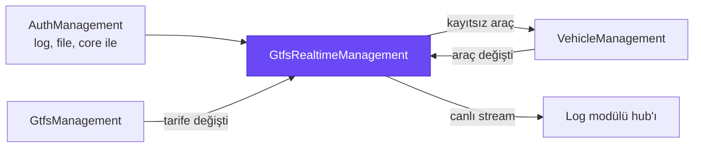
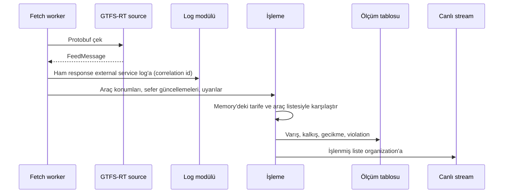
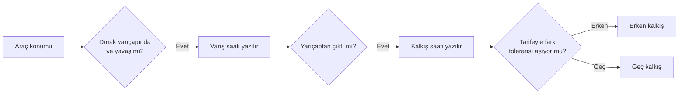

# Byd.GtfsRealtimeManagement

Canlı toplu taşıma verisinin modülü. Bir organization'ın GTFS-RT feed'lerini (araç konumları, sefer güncellemeleri, servis
uyarıları) düzenli aralıklarla çeker, aktif tarifeyle karşılaştırır, her durağa varış ve kalkışı ölçer, erken ya da geç
kalkışları işaretler ve sonucu bağlı ekranlara canlı olarak iter.



## Capabilities

| Capability | Ne sağlar |
|---|---|
| [Realtime source](#realtime-source) | Organization'ın GTFS-RT adreslerini tanımlama, tek aktif source |
| [Periyodik fetch](#periyodik-fetch) | Feed'leri organization'a özel aralıklarla çekme |
| [Varış ve kalkış ölçümü](#varış-ve-kalkış-ölçümü) | Araç konumundan durak bazında gerçek varış ve kalkış saati |
| [Violation tespiti](#violation-tespiti) | Erken ve geç kalkış, durak atlama, iptal edilen sefer |
| [Canlı stream](#canlı-stream) | İşlenmiş listeyi bağlı ekranlara anlık itme |
| [Kayıtsız araç kaydı](#kayıtsız-araç-kaydı) | Akışta görülen yeni aracı vehicle modülüne kaydettirme |
| [Anlık görünüm](#anlık-görünüm) | Aktif source'un feed'lerini istek anında DTO ya da GTFS-RT olarak okuma |
| [Ölçüm kanıtı](#ölçüm-kanıtı) | Her ölçümün hangi ham feed'den geldiği |
| [Organization setting'leri](#organization-settingleri) | Aralık, yarıçap ve toleransları organization bazında ayarlama |

## Nasıl çalışır



Organization'ın araçları ve aktif tarifesi bir kez yüklenip memory'de tutulur, her mesajda database'e gidilmez. Bu kopya
event'lerle güncellenir: GTFS'te tarife değişince tarife, vehicle'da araç değişince araç yeniden yüklenir.

## Realtime source

Source bir organization'ın GTFS-RT adresleridir: araç konumları, sefer güncellemeleri ve servis uyarıları için ayrı
adresler (en az biri dolu). Organization'ın aynı anda tek aktif source'u olur; `activate` öncekini pasife alır.

## Periyodik fetch

Worker her aktif source'un her feed'ini organization'ın setting'indeki aralıkla çeker. Aralık dolmadan aynı feed tekrar
çekilmez; fetch hata verse de aralık beklenir.

| Feed | Default aralık |
|---|---|
| Araç konumları | 10 sn |
| Sefer güncellemeleri | 10 sn |
| Servis uyarıları | 60 sn |

## Varış ve kalkış ölçümü

Araç konumu aktif tarifedeki durakla karşılaştırılır. Araç durağın yarıçapı içinde ve durma hızının altındaysa varmış,
yarıçaptan çıkınca kalkmış sayılır. Ölçülen saat tarifedeki saatle karşılaştırılır.



Bayat feed (default 120 sn'den eski) işlenmez. Seferin o gün çalışıp çalışmadığı GTFS takvim kuralıyla belirlenir.

## Violation tespiti

| Violation | Ne zaman |
|---|---|
| İptal edilen sefer | Feed seferi iptal ya da silinmiş bildirdi |
| Durak atlama | Sefer durağa uğramadan geçti |
| Erken kalkış | Tarifeden toleranstan (default 60 sn) daha erken |
| Geç kalkış | Tarifeden toleranstan (default 300 sn) daha geç |

Violation'lar ölçüm satırında tutulur; hat, sefer, araç ve violation türüne göre filtrelenerek raporlanır.

## Canlı stream

İşlenmiş liste log modülünün stream'i üzerinden organization'ın bağlı ekranlarına gider (`streamReceived`). Canlı araç
takibi için ayrıca bir query endpoint'i açılmaz; ekranlar stream'i dinler. Boş tam liste de gönderilir ki client elindekini
temizlesin.

## Kayıtsız araç kaydı

Akışta görülen ama kayıtlı olmayan her araç için bir kez `VehicleRegistrationRequestedEto` yayınlanır. Vehicle modülü
aracı "Realtime" kaynaklı olarak kaydeder ve araç event'iyle memory'deki listeye geri döner.

## Anlık görünüm

Aktif source'un feed'leri istek anında da okunur: `vehicle-positions`, `trip-updates`, `service-alerts` GTFS-RT alanlarıyla
DTO olarak; `feed-message` ise hepsini tek bir GTFS-RT `FeedMessage` olarak döner.

## Ölçüm kanıtı

Veri iki katmanda durur. Ham feed tabloya girmez, log modülünün external service log'unda durur. İşlenmiş ölçüm bu
modülün tablosundadır ve hangi ham fetch'ten geldiğini correlation id ile taşır; her ölçüm ham response'a kadar izlenir.
Tarife ve araç bilgisi kopyalanmaz, id ile bağlanır.

## Organization setting'leri

Bütün eşikler ABP setting'idir ve organization bazında değiştirilebilir.

| Setting | Default |
|---|---|
| Fetch aralıkları (araç konumu, sefer güncellemesi, uyarı) | 10 / 10 / 60 sn |
| Durak yarıçapı | 50 m |
| Durma hızı | 1.5 m/sn |
| Bayat feed sınırı | 120 sn |
| Erken / geç kalkış toleransı | 60 / 300 sn |

## Modülde kullanım

| Host ihtiyacı | Ne için |
|---|---|
| RabbitMQ | GTFS ve vehicle modülleriyle event alışverişi |
| Merkezi log host'u | Canlı stream ve external service log |
| GTFS modülünde aktif feed | Ölçüm aktif tarifeye göre yapılır |

Permission'lar: `GtfsRealtimeManagement.RealtimeSources`, `.RealtimeStopTimes` ve `.Lookups` için `View` / `Manage`.

## Geliştirme

```bash
dotnet build Byd.GtfsRealtimeManagement.slnx
dotnet test Byd.GtfsRealtimeManagement.slnx
```
